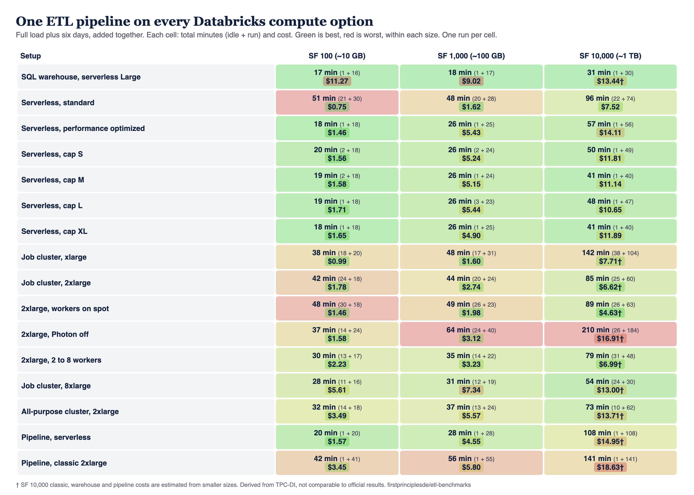
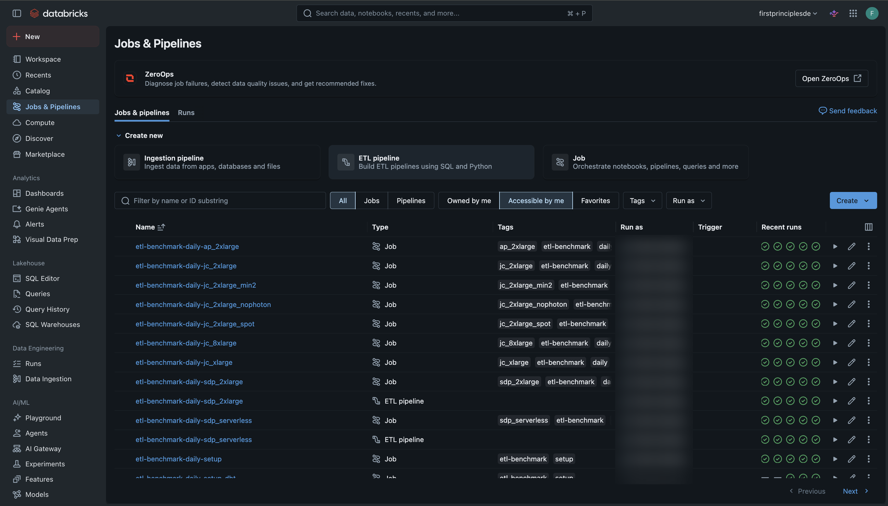
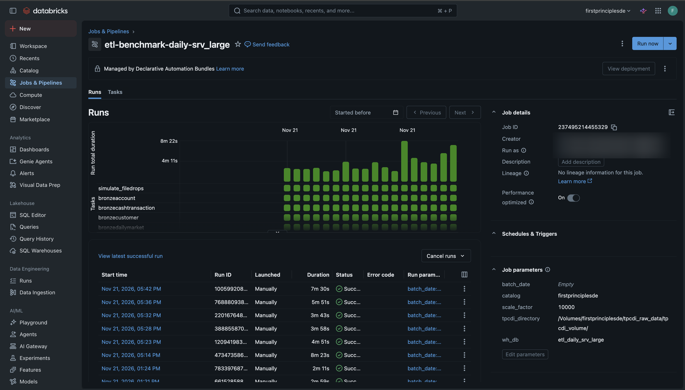
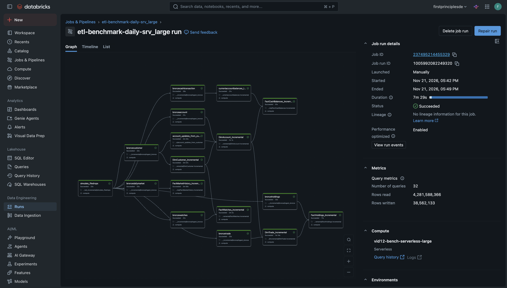
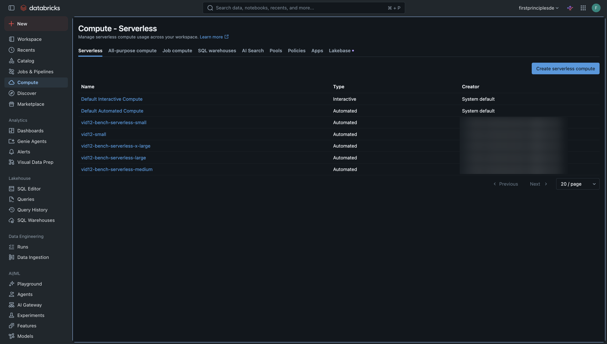
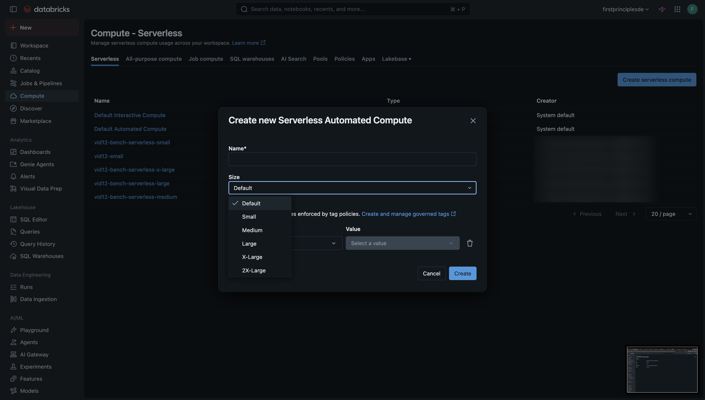

# etl-benchmarks

**What one ETL pipeline costs, and how long it takes, on each Databricks compute option: 14 setups, 294 runs, a full load plus six days at three data sizes, so you can pick compute from numbers.**

These benchmarks are on Databricks. I'll be testing other platforms and tools next, and they'll land in this repo as they're done.

[YouTube channel](https://www.youtube.com/@FirstPrinciplesDE) · [Conclusions](docs/conclusions.md) · [Every run](results/per_run.csv) · [Run it yourself](#run-it-yourself) · [License](LICENSE)

## The answer

- **Cheapest:** serverless standard, or close to it at every size. Nothing to size or tune. The cost is waiting: about 40% of its time is waiting for compute.
- **Fast, with a limit on spend:** a serverless size cap. As fast as performance optimized at SF 100 and 1,000, and better at SF 10,000 (medium: 41 min for $11.14, against 57 min for $14.11).
- **Fastest:** the SQL warehouse, at every size. A Large warehouse was also the most expensive in these runs, and it ran at Large for every size.
- **On classic job clusters:** spot is 18 to 30% cheaper in total for 4 to 14% more time. Photon off was slower and dearer at SF 1,000 and 10,000. All-purpose cost about double a job cluster. Never run scheduled jobs on all-purpose.

The reasoning for each is in [docs/conclusions.md](docs/conclusions.md).

## Results

Each cell is the **full load plus six days** added together: startup minutes (waiting for compute) + run minutes (working) = total minutes, and cost (Databricks plus AWS list price). Every cell is one run. In the picture, green is best and red is worst within each size.



<details><summary>Same table as text</summary>

| Setup | SF 100 | SF 1,000 | SF 10,000 |
|---|---|---|---|
| Serverless, Standard | startup 21 + run 30 = **51** min · **$0.75** | startup 20 + run 28 = **48** min · **$1.62** | startup 22 + run 74 = **96** min · **$7.52** |
| Serverless, Performance optimized | startup 1 + run 18 = **18** min · **$1.46** | startup 1 + run 25 = **26** min · **$5.43** | startup 1 + run 56 = **57** min · **$14.11** |
| Serverless Rate Limit, S | startup 2 + run 18 = **20** min · **$1.56** | startup 2 + run 24 = **26** min · **$5.24** | startup 1 + run 49 = **50** min · **$11.81** |
| Serverless Rate Limit, M | startup 2 + run 18 = **19** min · **$1.58** | startup 1 + run 24 = **26** min · **$5.15** | startup 1 + run 40 = **41** min · **$11.14** |
| Serverless Rate Limit, L | startup 1 + run 18 = **19** min · **$1.71** | startup 3 + run 23 = **26** min · **$5.44** | startup 1 + run 47 = **48** min · **$10.65** |
| Serverless Rate Limit, XL | startup 1 + run 18 = **18** min · **$1.65** | startup 1 + run 25 = **26** min · **$4.90** | startup 1 + run 40 = **41** min · **$11.89** |
| Jobs Compute, xlarge | startup 18 + run 20 = **38** min · **$0.99** | startup 17 + run 31 = **48** min · **$1.60** | startup 38 + run 104 = **142** min · **$7.71** |
| Jobs Compute, 2xlarge | startup 24 + run 18 = **42** min · **$1.78** | startup 20 + run 24 = **44** min · **$2.74** | startup 25 + run 60 = **85** min · **$6.62** |
| Jobs Compute, 2xlarge, spot workers | startup 30 + run 18 = **48** min · **$1.46** | startup 26 + run 23 = **49** min · **$1.98** | startup 26 + run 63 = **89** min · **$4.63** |
| Jobs Compute, 2xlarge, Photon off | startup 14 + run 24 = **37** min · **$1.58** | startup 24 + run 40 = **64** min · **$3.12** | startup 26 + run 184 = **210** min · **$16.91** |
| Jobs Compute, 2xlarge, 2 to 8 workers | startup 13 + run 17 = **30** min · **$2.23** | startup 14 + run 22 = **35** min · **$3.23** | startup 31 + run 48 = **79** min · **$6.99** |
| Jobs Compute, 8xlarge | startup 11 + run 16 = **28** min · **$5.61** | startup 12 + run 19 = **31** min · **$7.34** | startup 24 + run 30 = **54** min · **$13.00** |
| All-Purpose Compute, 2xlarge | startup 14 + run 18 = **32** min · **$3.49** | startup 13 + run 24 = **37** min · **$5.57** | startup 10 + run 62 = **73** min · **$13.71** |
| Serverless SQL warehouse, Large | startup 1 + run 16 = **17** min · **$11.27** | startup 1 + run 17 = **18** min · **$9.02** | startup 1 + run 30 = **31** min · **$13.44** |

</details>


† SF 10,000 classic and warehouse costs are estimates from smaller sizes, see [docs/cost-provenance.md](docs/cost-provenance.md). Per-setup detail (full load and an average day, separately): [results/final_table.md](results/final_table.md).

> [!IMPORTANT]
> One run per cell, so don't trust a two percent gap. AWS costs are node-hours times a price list, not Cost Explorer. Warehouse and all-purpose per-run costs are hourly billing divided between runs by time. This is derived from TPC-DI, not an official TPC-DI result, and is not comparable to published results.

## What was tested

| Group | Setups |
|---|---|
| Serverless jobs | `srv_standard`, `srv_optimized`, `srv_small`, `srv_medium`, `srv_large`, `srv_xlarge` (size caps) |
| Job cluster (m8gd, 1 to 8 workers, driver on demand) | `jc_xlarge`, `jc_2xlarge`, `jc_8xlarge` |
| 2xlarge experiments | `jc_2xlarge_spot`, `jc_2xlarge_nophoton`, `jc_2xlarge_min2`, `ap_2xlarge` (all-purpose) |
| SQL warehouse | `wh_large` (serverless, Large) |

Two tests per setup and size: a **full load** (the original TPC-DI single batch, whole job with start-up) and **six days** in a row (each day its own cold run, so every day pays its own start-up). The warehouse's six days ran as dbt, with the SQL on the warehouse, because a warehouse can't run the Python streaming notebooks. Data sizes: SF 100 (about 10 GB), SF 1,000 (about 100 GB), SF 10,000 (about 1 TB). Region: AWS us-east-1.

## How it was set up

The workload is **[Shannon Barrow's databricks-tpc-di](https://github.com/shannon-barrow/databricks-tpc-di)**, a Databricks implementation of TPC-DI (a retail brokerage ETL benchmark). All the credit goes to him. His code runs unchanged; this repo adds the Databricks Asset Bundle that creates one job per setup, the cold-start rules, and the measurement.

> [!NOTE]
> This is derived from TPC-DI. It is not comparable to published TPC-DI results because it does not meet all of the benchmark's requirements, and no TPC metric is reported.

How each run is made fair:

1. **Cold start every time.** Job clusters are new per run. The warehouse is stopped and the all-purpose cluster terminated before each run. Serverless has no off switch, so its start-up is whatever Databricks gives you.
2. **Same data and code** for every setup. Photon is on except where tested off, workers are on demand except where tested on spot, and the driver is always on demand.
3. **Idle counts.** The warehouse bills until auto-stop (5 minutes) and the all-purpose cluster until auto-termination (10 minutes), so cost includes that tail.
4. **Cost** is Databricks list price (`system.billing.usage` times `system.billing.list_prices`) plus AWS node-hours times a price list for classic compute.

What it looked like in the workspace:



| One setup's run history | One run's 17-task graph |
|---|---|
|  |  |

| Serverless size caps (Beta) | Creating one |
|---|---|
|  |  |

More: [a cap's detail page](docs/screenshots/05-serverless-large-details.png), [the benchmark schemas in the catalog](docs/screenshots/07-catalog-schemas.png). The build log and the checks against Databricks docs are in [docs/how-it-was-built.md](docs/how-it-was-built.md).

## Run it yourself

> [!WARNING]
> Running all of it costs real money: the whole benchmark was about $525 at list price. Start with one setup at SF 100. I could not re-run these commands on a clean workspace after the benchmark, so treat the steps as the shape of the setup, not a tested recipe.

1. Import the [databricks-tpc-di](https://github.com/shannon-barrow/databricks-tpc-di) repo into your workspace and generate the data for your scale factor with its Driver notebook, once per size.
2. Create the serverless size compute objects (Beta, enabled by an admin on the Previews page) and put their IDs in `databricks/scripts/serverless_ids.json`.
3. Generate and deploy the bundle, then run a job by its key:

```bash
cd databricks
python3 scripts/gen_resources.py
databricks bundle deploy -p <profile> --var tpcdi_path=/Workspace/Users/<you>/databricks-tpc-di --var scale_factor=100
databricks bundle run full_srv_standard -p <profile> --var tpcdi_path=/Workspace/Users/<you>/databricks-tpc-di
```

Job keys are `full_<setup>` and `daily_<setup>`; run `daily_<setup>` six times for the six days, after `daily_setup`. See [databricks/README.md](databricks/README.md).

## What's inside

| Path | What |
|---|---|
| [`docs/conclusions.md`](docs/conclusions.md) | The conclusions, by section |
| [`docs/design.md`](docs/design.md) | How the benchmark was designed |
| [`docs/cost-provenance.md`](docs/cost-provenance.md) | Where each cost number came from |
| [`docs/how-it-was-built.md`](docs/how-it-was-built.md) | What was done, in order, and what was checked |
| [`results/`](results/) | `final_table.md` and `per_run.csv` (294 runs) |
| [`databricks/`](databricks/) | The bundle and the generator |
| [`scripts/check_numbers.py`](scripts/check_numbers.py) | Recomputes the headline numbers from the results table |

## License

[MIT](LICENSE).
